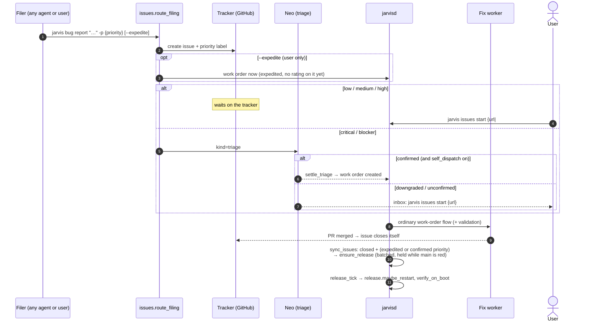

# Agents: bugs and releases

Any agent can file an OS bug with the `report-jarvis-bug` skill (`jarvis bug report`).
**The priority routes it.** Neo re-assesses a claim of `critical` or `blocker`.
`--expedite` is a scheduling decision that only the user can make: inside a work order
(`JARVIS_WO_ID` set) it is ignored.

Several fixes that land close together ship as **one** release. A red `main` holds
the release instead of shipping it.
