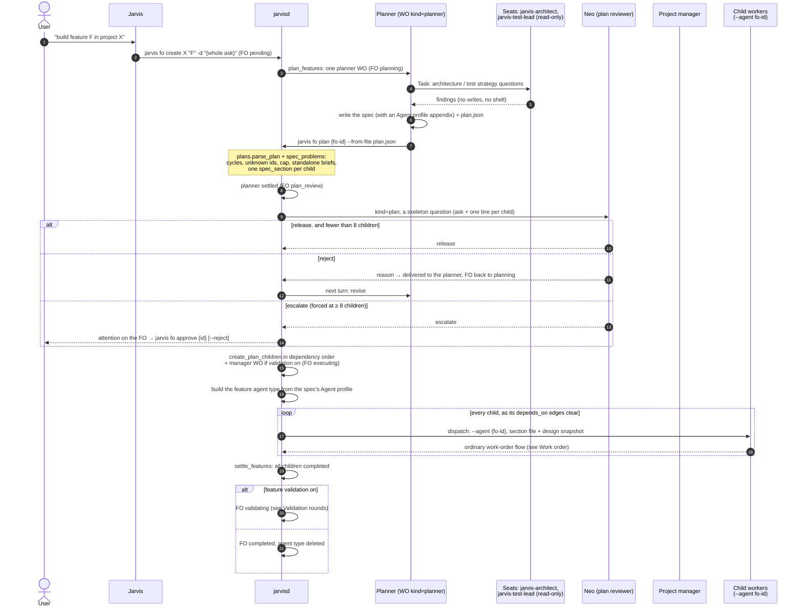
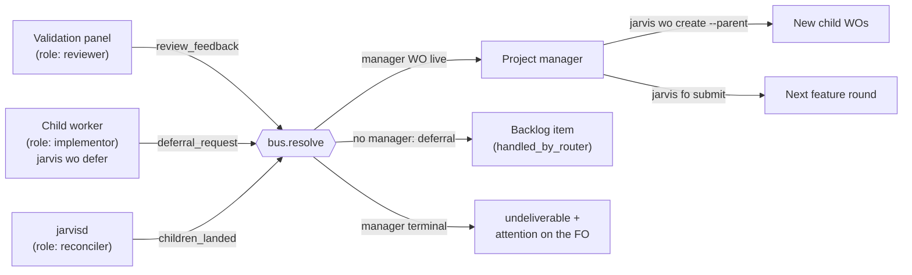

# Agents: feature order

A feature order (`jarvis fo create`) is an ask too big for one session. The OS plans it
itself, and no new scheduler is involved. The children are ordinary work orders joined
by `depends_on` edges. States and validator rules:
[Feature orders](/architecture/feature-orders.md).

## Plan, review, execute

## The project manager's mailbox

The manager is the only agent that works on a feature *after* its plan is released.
It is a work order that sleeps in `idle` and takes no concurrency slot. Envelopes are
its only input.

## When a child fails

A failed child fails its feature, because `failed` is settled. If the child later
recovers, the OS reopens the feature within a tick. If the child is genuinely dead,
`jarvis fo resume <id> --fix "…"` marks it superseded and files the fix as a new child.
