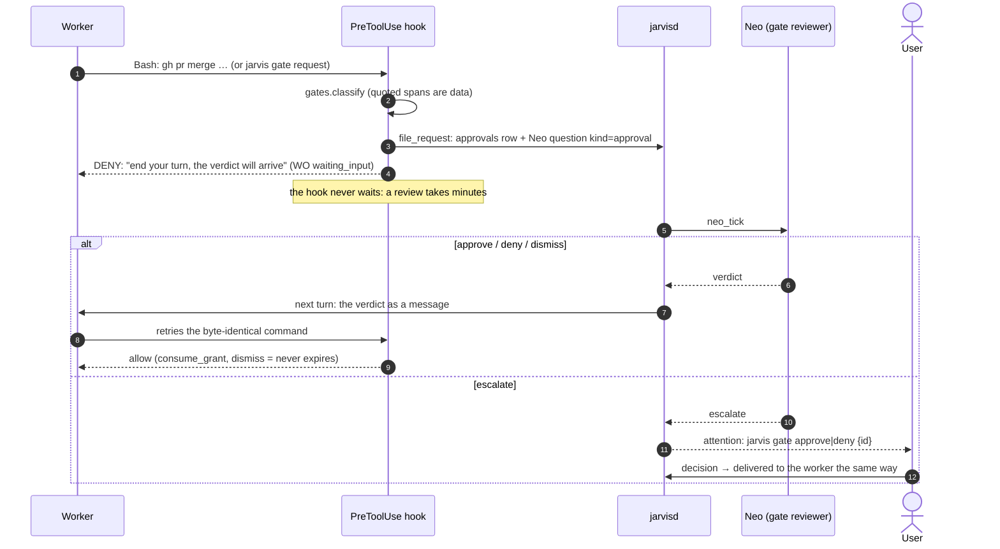
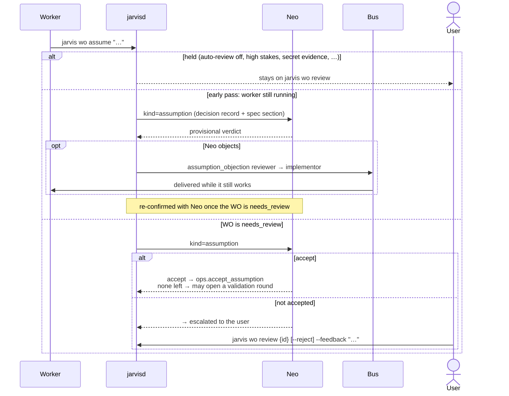

# Agents: gates and assumptions

Neo stands in for the user. Each thing an agent needs decided becomes a **question** in
`neo.db`, and its `kind` names the persona that answers it and the handler that delivers
the verdict (`Daemon._neo_drain`).

| Kind | Filed by | Verdict delivered to |
|---|---|---|
| `question` | a worker: `jarvis wo ask` | the worker's next turn; escalation → user |
| `approval` | a gated command (hook), auto-merge, a supervisor remedy | `_deliver_gate_verdict` → approvals row (+ worker message) |
| `plan` | a planner: `jarvis fo plan` | `_deliver_plan_verdict` → release / back to planner / user |
| `assumption` | `autoreview`, on a pending assumption | `_deliver_assumption_verdict` → accept, or escalate to user |
| `alarm` | the supervisor | `_deliver_alarm_verdict` → advice on the WO, or user |
| `triage` | `jarvis bug report` at critical/blocker | `issues.settle_triage` → label + route |

When `os.neo.panel` is enabled (it is off by default), `question` and `approval` are
answered by a seat panel instead of a single call. A `premise` seat answers likely
classifier false positives alone. Every real privileged action goes through the full
panel and the `chair`.

## A privileged command (gate)

While Neo holds the gate, the user's attention is not spent: `_waiting_on_neo_gate`
suppresses the flag.

## Assumptions and Neo's auto-review

A worker records a judgment call with `jarvis wo assume`. The default reviewer is the
user (`jarvis wo review`). A project can hand routine ones to Neo with
`validation.auto_review`. Neo can only **accept** or pass the decision to the user.

