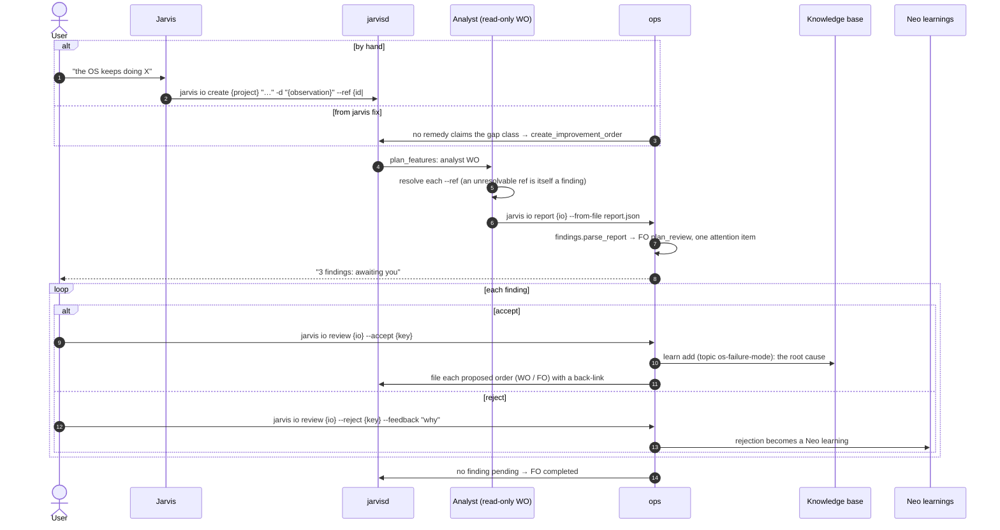

# Agents: improvement order

An improvement order (`jarvis io create`) is filed when the OS **misbehaves** and the
user wants the cause. It is a feature order with `kind=improvement`, carrying one
`analyst` work order (read-only, `dispatch.READ_ONLY_KINDS`). The analyst is told to
argue *against* the obvious fix. It never opens a PR. Unlike an investigation, it does
not settle itself: **nothing is filed until the user decides**.

A send-back can reach the analyst as its next turn, and it may resubmit while the order
is in `plan_review`.
