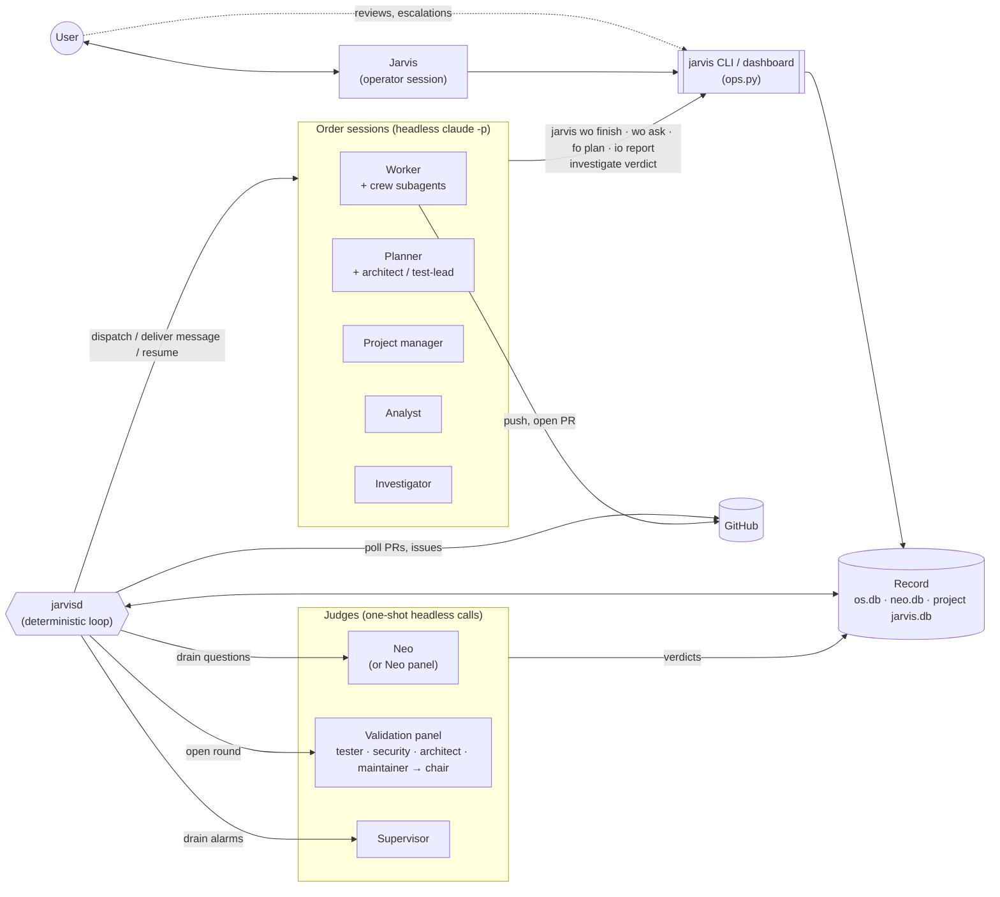

# Agents of the OS

Every model-backed actor in the OS, and how they connect. One page per use case
follows. Each page shows **who talks to whom**. The states themselves are in
[Work-order lifecycle](/architecture/work-order-lifecycle.md) and
[Feature orders](/architecture/feature-orders.md).

## The one rule

**No agent calls another agent.** Each agent writes to the record, through a
`jarvis …` command, a hook or a stored verdict. `jarvisd` (`daemon.py`) is plain
Python with no model in it. On each tick it reads the record and starts the next
agent. Messages between orders are *envelopes* addressed to a **role**, not to a
recipient (`bus.py`). That is why every diagram on these pages has the daemon in
the middle.

## Roster

| Agent | Runs as | Started by | Writes code? | Defined in |
|---|---|---|---|---|
| **Jarvis** (operator) | the user's own interactive Claude session in the repo | the user | no: operates through the CLI | `CLAUDE.md` |
| **Worker** (`kind=worker`) | headless `claude -p` turns in its own worktree, one turn at a time | `Daemon.dispatch_pending` | yes, through its crew | `dispatch.build_worker_prompt` |
| ↳ crew: `jarvis-implementer`, `jarvis-spec-writer` | background Task subagents of the worker | the worker | yes: the lead's own Edit/Write is refused by a hook (`hooks.py`, `LONG_SEATS`) | `assets/worker-agents/` |
| ↳ **feature agent type** | the worker's *identity* (`--agent <fo-id>`) for every child of a feature | dispatch | n/a | the spec's `Agent profile` appendix (`specs.py`) |
| **Planner** (`kind=planner`) | a work order | `Daemon.plan_features` | only the spec and `plan.json` | `dispatch._planner_prompt` |
| ↳ seats: `jarvis-architect`, `jarvis-test-lead` | read-only Task subagents of the planner (Read/Grep/Glob + Serena) | the planner | no | `assets/agents/` |
| **Project manager** (`kind=manager`) | a work order that stays `idle` between messages and takes no concurrency slot | plan release, only when validation is on | no: it files child orders | `dispatch._manager_prompt` |
| **Analyst** (`kind=analyst`) | a read-only work order under an improvement order | `Daemon.plan_features` | no | `dispatch._analyst_prompt` |
| **Investigator** (`kind=investigator`) | a read-only work order under an investigation order; hooks refuse every write except `verdict.json` | `Daemon.plan_features` | no | `dispatch._investigator_prompt` |
| **Neo** | one headless call per question, on the daemon's Neo thread | `Daemon.neo_tick` | no | `neo.py` (+ `gates.REVIEWER_PERSONA`, `plans.PLAN_REVIEWER_PERSONA`) |
| ↳ Neo panel: `premise`, `record`, `blast`, `taste`, `chair` | profiled seats instead of one call (**off by default**) | `Daemon._panel_answer` | no | `panel.py`, `assets/neo-seats/` |
| **Validation panel**: `tester`, `security`, `architect`, `maintainer` + `chair` | four blind, concurrent headless calls, then a chair | `Daemon.validation_tick` | no | `validation.py`, `assets/validator-seats/` |
| **Supervisor** | one structured headless call per alarm, plus a health-sweep call | `Daemon.supervisor_tick` / `health_tick` | no | `supervisor.py`, `probes.py` |
| **Digest** | one call that shortens a long question for display only | `Daemon.digest_tick` | no | `digest.py` |

## Topology

## Who answers to whom

- A **work order** blocks on its user, but in practice it reaches Neo first. A question
  (`jarvis wo ask`), a gated command and an assumption all go to Neo. The user sees only
  what Neo escalates.
- **Delivered work** goes to the validation panel, then to auto-merge or the user.
- **A plan** goes to Neo. It reaches the user only when it escalates, which is forced at
  `CHILD_CAP` = 8 children or more.
- **An alarm** goes to the supervisor, then to Neo, then to the user.
- **Findings from an improvement order** always go to the user.
- **An investigation** settles itself. Only `WAITING_ON_USER` asks for the user.

## Use cases

- [Work order](/architecture/agents/work-order.md): dispatch, turns, questions, settlement.
- [Validation rounds](/architecture/agents/validation.md): the panel, rejection, rounds, auto-merge.
- [Feature order](/architecture/agents/feature-order.md): planner, plan review, children, manager.
- [Gates and assumptions](/architecture/agents/gates-and-assumptions.md): privileged actions, Neo's auto-review.
- [Investigation order](/architecture/agents/investigation.md): read-only diagnosis, four verdicts.
- [Improvement order](/architecture/agents/improvement.md): analyst findings, user review.
- [Supervisor and self-heal](/architecture/agents/supervisor.md): alarms, health sweep, remedies.
- [Bugs and releases](/architecture/agents/bugs-and-releases.md): triage, expedite, release on landing.
