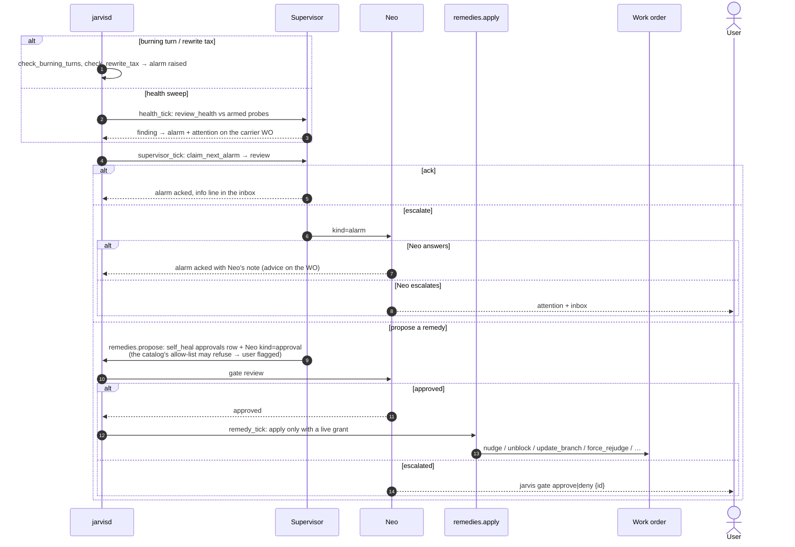

# Agents: supervisor and self-heal

The supervisor is **not** a work order. It is a one-shot structured headless call
(`supervisor.review`) on the daemon's supervisor thread, with a neutral working
directory. It judges one alarm at a time. A second call, the health sweep
(`supervisor.review_health`), judges orders against the armed probes (`probes.py`). It
can only act through `remedies.py`, a closed registry, and only after Neo approves a
`self_heal` gate.

`self_heal` is the one gate that no command classifies into. It is mandatory, whatever
the project's gate config says. Its "command" is a rendered intent that nothing
executes. See [Privileged-action gates](/architecture/gates.md).
