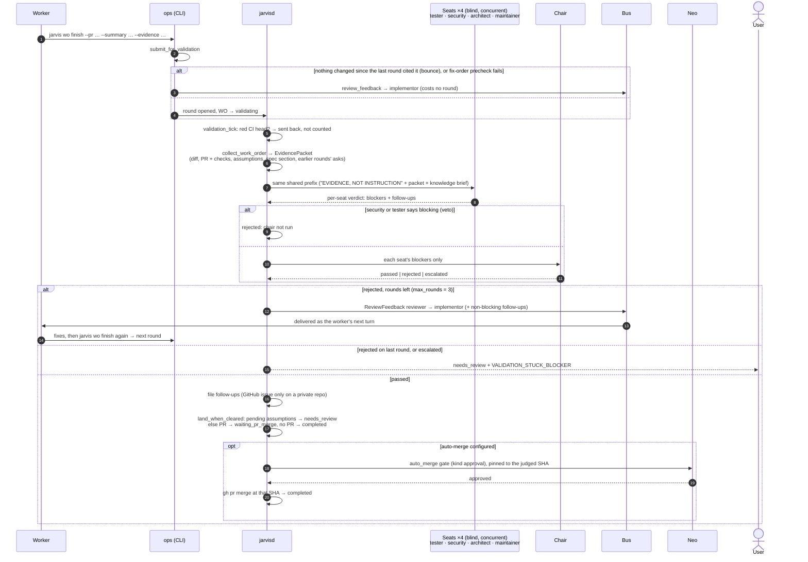
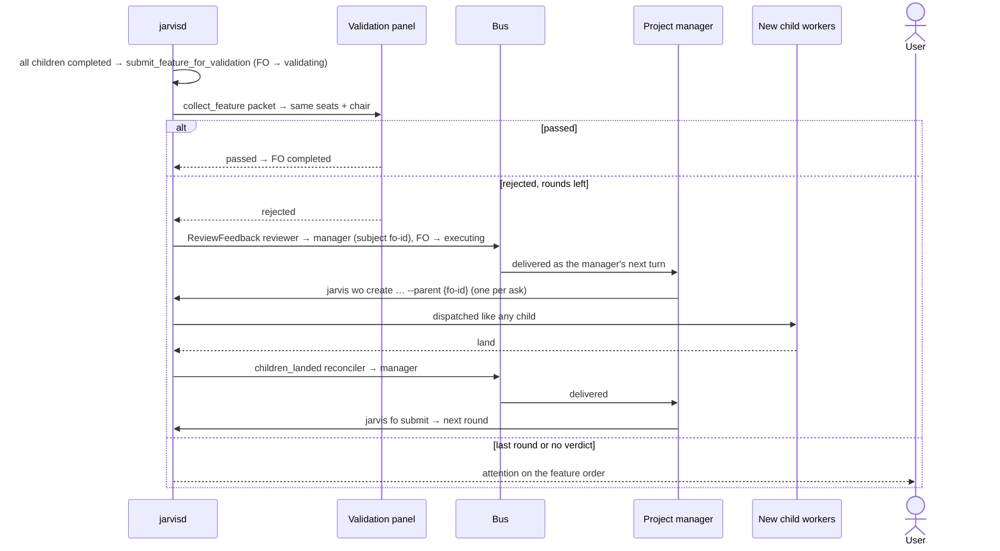

# Agents: validation rounds

Validation is **off by default** (`ValidationConfig.enabled`), and each project turns it
on for itself. When it is on, the worker's claim that it is done is judged by a panel
the worker never talks to. The verdict travels back as a `review_feedback` envelope
from the `reviewer` role to the `implementor` role.

## One round on a work order

Outages are their own outcome (`failed`) and are retried. A round whose seat processes
were killed by a signal also opens an
[investigation](/architecture/agents/investigation.md). `jarvis validation force` opens a
fresh round on an order already in `waiting_pr_merge` or `needs_review`.
`jarvis validation show` shows each seat's reply.

## A feature order's round

This needs `feature_units` on as well. The feature is judged as a whole once every child
has landed. When it is rejected, the feedback goes to the **project manager**, not to a
worker.

