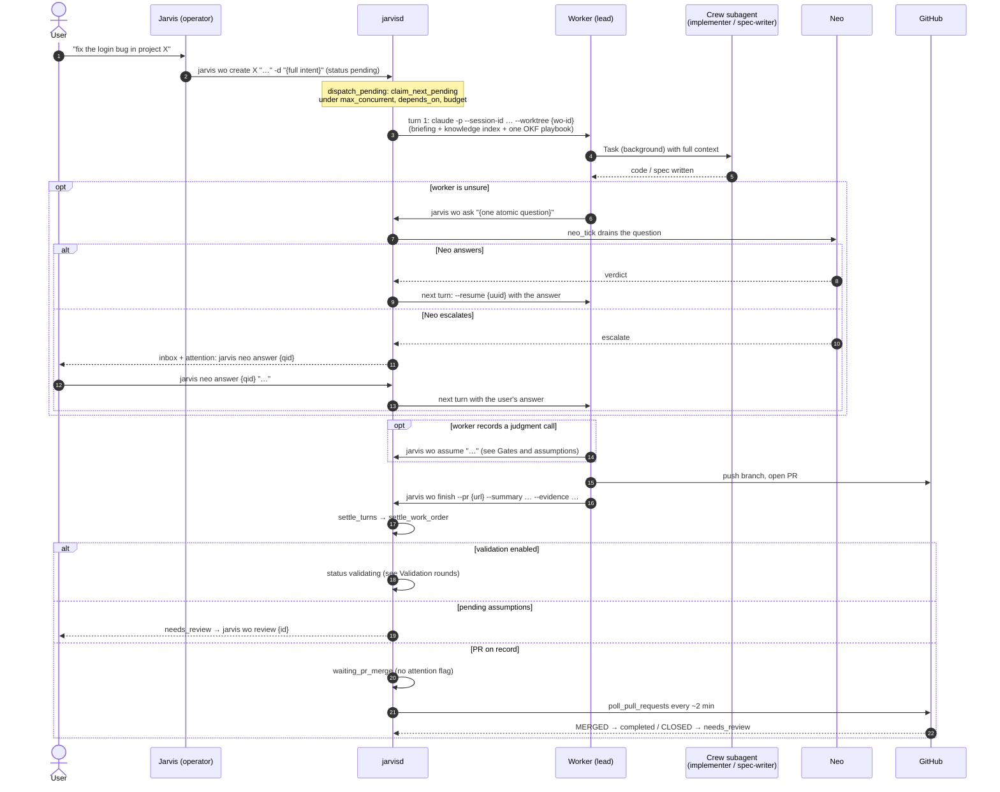
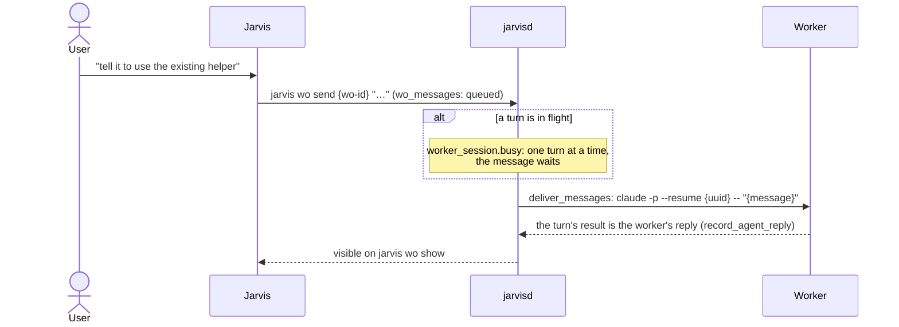
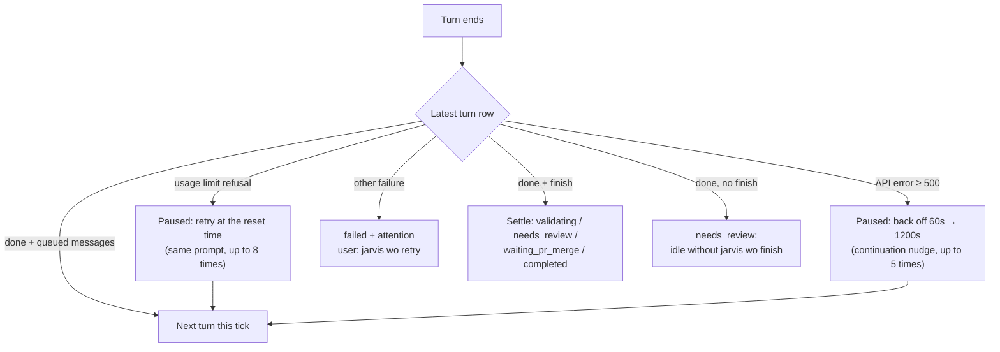

# Agents: work order

Roster and conventions: [Agents of the OS](/architecture/agents/overview.md). The full
state machine and transport are in
[Work-order lifecycle](/architecture/work-order-lifecycle.md).

## From ask to settlement

## Feedback while it runs

The user never writes into a worker's session directly. Feedback goes in as a queued
message, and the daemon delivers it as the worker's next turn.

## When a turn dies

